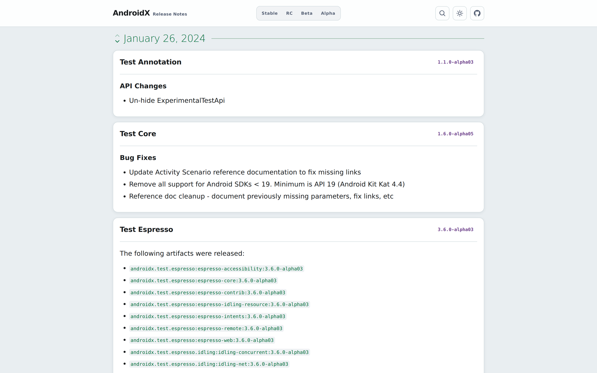

# AndroidX Release Notes

Browse AndroidX release notes across libraries and dates in one place.

- 🗓️ **Timeline:** Read the entire history of release notes.
- 🎛️ **Stability:** Filter Stable, RC, Beta, or Alpha releases.
- 🔎 **Search:** Find libraries and versions across the full timeline.
- ✨ **Less repetition:** Skip repeated metadata and focus on the changes.
- 🔗 **Compact links:** Open issues, reviews, GitHub references, and commits.

> [!TIP]
> 🔔 Follow releases via **Watch ➞ Custom ➞ Releases**.  
> 📡 Or subscribe to the GitHub releases [Atom feed](https://github.com/SimonMarquis/androidx-release-notes/releases.atom).

<a href="https://simonmarquis.github.io/androidx-release-notes/">
  <picture>
    <!-- Smartphone -->
    <source media="(max-width: 600px) and (prefers-color-scheme: dark)" srcset="art/smartphone-dark.png">
    <source media="(max-width: 600px)" srcset="art/smartphone-light.png">
    <!-- Tablet -->
    <source media="(min-width: 601px) and (max-width: 1023px) and (prefers-color-scheme: dark)" srcset="art/tablet-dark.png">
    <source media="(min-width: 601px) and (max-width: 1023px)" srcset="art/tablet-light.png">
    <!-- Desktop -->
    <source media="(min-width: 1024px) and (prefers-color-scheme: dark)" srcset="art/desktop-dark.png">
    <source media="(min-width: 1024px)" srcset="art/desktop-light.png">
    
  </picture>
</a>

---

## Implementation

A single Kotlin script, [`androidx-release-notes.main.kts`](scripts/androidx-release-notes.main.kts), imports official release notes into a JSON cache in [`data`](data/).  
The site in [`docs`](docs/) and the [GitHub releases](https://github.com/SimonMarquis/androidx-release-notes/releases) are built only from that cache.

### Sources

- [Release notes feed](https://developer.android.com/feeds/androidx-release-notes.xml): recent entries.
- [All-channel releases](https://developer.android.com/jetpack/androidx/versions/all-channel): full history.
- [Library release pages](https://developer.android.com/jetpack/androidx/versions): per-version notes and commit ranges.

### Data

Each `data/YYYY-MM-DD.json` holds one release entry and its component releases.  
Set `ignored: true` to hide an entry and prevent re-import.

### Commands

Run `./scripts/androidx-release-notes.main.kts <command>` from the repository root.

| Command | Operation |
| --- | --- |
| `sync-rss` | Import new or updated entries from the feed. |
| `ignore <YYYY-MM-DD>` | Ignore every entry for a date. |
| `build-site` | Generate the HTML pages. `--embedded` inlines assets; add `--minified` to inline previously generated minified CSS and JS. |
| `sync-releases` | Create, update, or delete one GitHub release per date. `--changed-from SHA` limits it to changed dates. |
| `import-history` | Import new entries from the all-channel page. |

### Workflows

-  runs `sync-rss` periodically and commits new JSON in `data/`.
-  rebuilds `docs/`, refreshes `art/` screenshots, and syncs releases.
-  builds self-contained preview pages and screenshots on PRs.

Workflows push as a GitHub App (`APP_CLIENT_ID`, `APP_PRIVATE_KEY` secrets).  
GitHub Pages serves [`docs`](docs/) from `main`.
