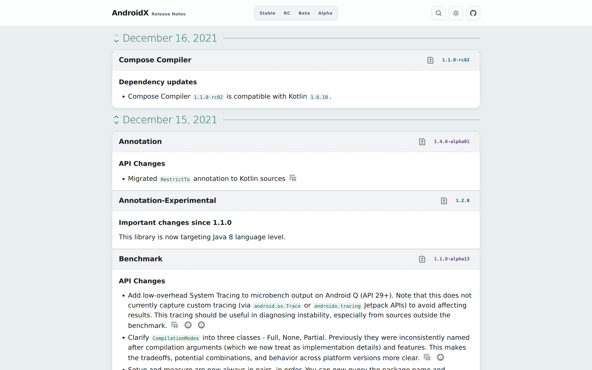

# AndroidX Release Notes

Browse AndroidX release notes across libraries and dates in one place.

- 🗓️ **Timeline:** Read the entire history of release notes.
- 🎛️ **Stability:** Filter Stable, RC, Beta, or Alpha releases.
- 🔎 **Search:** Find libraries and versions across the full timeline.
- ✨ **Less repetition:** Skip repeated metadata and focus on the changes.
- 🔗 **Compact links:** Open issues, reviews, GitHub references, and commits.

> [!TIP]
> 🔔 Follow releases via **Watch ➞ Custom ➞ Releases**.  
> 📡 Or subscribe to the GitHub releases [Atom feed](https://github.com/SimonMarquis/androidx-release-notes/releases.atom).

<a href="https://simonmarquis.github.io/androidx-release-notes/">
  <picture>
    <!-- Smartphone -->
    <source media="(max-width: 600px) and (prefers-color-scheme: dark)" srcset="art/smartphone-dark.png">
    <source media="(max-width: 600px)" srcset="art/smartphone-light.png">
    <!-- Tablet -->
    <source media="(min-width: 601px) and (max-width: 1023px) and (prefers-color-scheme: dark)" srcset="art/tablet-dark.png">
    <source media="(min-width: 601px) and (max-width: 1023px)" srcset="art/tablet-light.png">
    <!-- Desktop -->
    <source media="(min-width: 1024px) and (prefers-color-scheme: dark)" srcset="art/desktop-dark.png">
    <source media="(min-width: 1024px)" srcset="art/desktop-light.png">
    
  </picture>
</a>

## Implementation

A single Kotlin script, [`androidx-release-notes.main.kts`](scripts/androidx-release-notes.main.kts), syncs official release notes into a JSON cache in [`data`](data/).  
The site (built in [`site/`](site), with the hand-written files of [`static`](static/)) and the [GitHub releases](https://github.com/SimonMarquis/androidx-release-notes/releases) are built only from that cache.

### Glossary

| Term | Meaning | Example |
| --- | --- | --- |
| **group** | A release page. Not always a Maven groupId: `compose-ui` is `androidx.compose.ui`, `test` hosts `androidx.test.*`. | [`core`](https://developer.android.com/jetpack/androidx/releases/core) |
| **artifact** | A section of a group page, releasing one or more Maven artifacts together; the group itself when the page has no sections. | [`core-performance`](https://developer.android.com/jetpack/androidx/releases/core#core-performance_2) |
| **version** | A dated version section of an artifact. | [`1.0.0-rc01`](https://developer.android.com/jetpack/androidx/releases/core#1.0.0-rc01) |
| **release** | All versions released on a date: one `data/YYYY-MM-DD.json`. | [`2026-11-11`](data/2026-11-11.json) |
| **entry** | One artifact version of a release. | |

### Sources

- [Release notes feed](https://developer.android.com/feeds/androidx-release-notes.xml): recent releases.
- [All-channel releases](https://developer.android.com/jetpack/androidx/versions/all-channel): full history.
- [Release pages](https://developer.android.com/jetpack/androidx/versions): per-version dates, notes, and commit ranges.

### Data

Each `data/YYYY-MM-DD.json` holds one release.

### Commands

Run `./scripts/androidx-release-notes.main.kts <command>` from the repository root.

| Command | Operation |
| --- | --- |
| `sync rss` | Sync every version of every release page linked by the new or updated feed releases. |
| `sync all-channel` | Sync every version of every release page linked by the all-channel page. |
| `sync groups <group>[,<group>…]` | Sync every version of release pages, e.g. `sync groups core,camera`. |
| `ignore <YYYY-MM-DD>` | Ignore the release of a date. |
| `build` | Generate the site in `site/`. `--embedded` inlines assets; `--minified` uses the minified assets generated by `npm ci && npm run minify`. |
| `releases` | Create, update, or delete one GitHub release per date. `--changed-from SHA` limits it to changed dates. |

### Workflows

-  runs `sync rss` periodically and commits new JSON in `data/`.
-  runs `sync all-channel` weekly and opens a PR when `data/` drifts.
-  builds and deploys the site, refreshes `art/` screenshots, and syncs releases.
-  builds self-contained preview pages and screenshots on PRs.

Workflows push as a GitHub App (`APP_CLIENT_ID`, `APP_PRIVATE_KEY` secrets).  
GitHub Pages deploys the site built in `site/` as an artifact.
